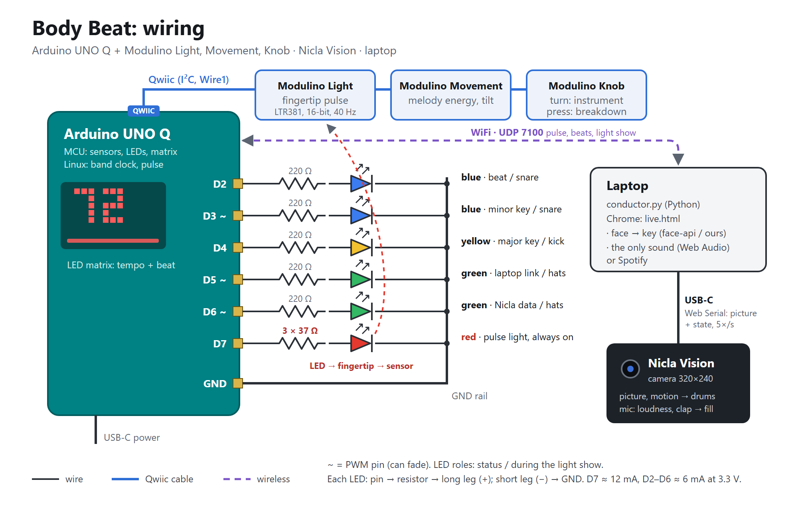

# Body Beat

**A band that plays along with your body.** Your heartbeat sets the tempo, your face picks the key,
your movement drives the drums and the melody, and a clap starts a drum fill. An Arduino UNO Q, a Nicla Vision
and a laptop browser each play their part, and five LEDs run a light show on the beat.

Built at DurHack 2026.



There is also an interactive 3D model of the build: open [`docs/circuit3d.html`](docs/circuit3d.html) in a browser
(download it first; GitHub shows it as source).

## How it plays

| You do | Sensed by | The band does |
|---|---|---|
| Rest a fingertip on the red LED | Modulino Light (pulse, 40 readings a second) | **Tempo** follows your heart rate, and holds it if your finger slips |
| Make a face | Nicla Vision camera → expression model in the browser | **Key**: happy / surprised = C major, neutral = D dorian, sad / angry / fearful / disgusted = A minor |
| Move in front of the camera | Nicla Vision (frame difference) | **Drums** get busier, from 4 patterns |
| Clap | Nicla Vision microphone | **Drum fill** |
| Move or tilt the board | Modulino Movement | **Melody** energy and direction |
| Turn / press the knob | Modulino Knob | **Instrument** / **breakdown** |
| Walk away | no face for 10 s | The band drops to a quiet backing |

The laptop browser is the only thing that makes sound (Web Audio: drums, bass, pads and leads, with reverb,
echo and a limiter). It can also play your own Spotify playlists, picking the energy from your heart rate.

## Hardware

| Part | Notes |
|---|---|
| Arduino UNO Q | MCU half runs `unoq/sketch`, Linux half runs `unoq/python` (band clock, pulse) |
| Modulino Light, Movement, Knob | One Qwiic chain: UNO Q → Light → Movement → Knob |
| 5 LEDs + 220 Ω | D2 blue, D3 blue, D4 yellow, D5 green, D6 green: status lights, then the light show |
| 1 red LED + 3 × 37 Ω in series | D7, always on: shines through the fingertip onto the Light sensor |
| Arduino Nicla Vision | USB-C to the laptop. Camera picture, motion, mic. No model on the board |
| Laptop | Python 3 + Chrome or Edge (Web Serial) |

Each LED: pin → resistor → long leg (+); short leg (−) → GND. The full pin table is at the top of
[`unoq/sketch/sketch.ino`](unoq/sketch/sketch.ino).

## Run it

**1. Nicla Vision** (once; about 5 minutes the first time):

```
arduino-cli compile -b arduino:mbed_nicla:nicla_vision nicla_web
arduino-cli upload  -b arduino:mbed_nicla:nicla_vision -p COM11 nicla_web
```

**2. UNO Q** (once): add `unoq/` to Arduino App Lab as an app, add the `Arduino_Modulino` library, and run it.
The board must know the laptop's address: put it in `unoq/python/peers.txt` (one address per line), or set `BB_PEERS`.
Put the UNO Q and the laptop on the same WiFi.

**3. Laptop** (every time):

```
python laptop/conductor.py              # with the UNO Q
python laptop/conductor.py --sim        # no hardware: a simulated UNO Q and Nicla
python laptop/conductor.py --peer <UNO Q IP>   # WiFi that blocks broadcasts
```

Open **http://127.0.0.1:8000** in Chrome or Edge, click **Start the band**, then **Connect Nicla (USB)**.
Optional: **Start mic**, **Send clock**, **Start webcam** (a webcam pulse stands in when there is no finger pulse).

## The face model

The key comes from our own expression model, trained on FER2013 with Microsoft's FER+ labels
([`model/train_expression.ipynb`](model/train_expression.ipynb), about 20 minutes on a free Colab GPU).
[face-api](https://github.com/vladmandic/face-api) finds the face; our model reads the expression on it.

| FER+ test faces | 7 expressions | 3 keys | Size |
|---|---|---|---|
| face-api expression model | 64.7% | 73.3% | 322 KB |
| **Body Beat model** | **79.8%** | **83.3%** | **109 KB** |

It runs in the browser on plain tf.js ops, checks itself against the notebook's answers when it loads, and falls back
to face-api if anything is wrong. The **Expression model** menu can switch to face-api, or show both side by side.
Details and caveats: [`model/README.md`](model/README.md).

## Spotify (optional)

Instead of the generated band, Body Beat can play your own Spotify playlists on a phone or desktop app:
your heart rate picks Warm-up, Steady (from 100 BPM) or High energy (from 135 BPM), and the playlist changes a few
seconds after you enter a new range. It never skips a track or overrides your pause.

1. Create an app at https://developer.spotify.com/dashboard (Web API) with the redirect URI `http://127.0.0.1:8000/live.html`.
   Development-mode apps need a Premium account, and each listener added under *User Management*.
2. Open http://127.0.0.1:8000/live.html, choose **Spotify**, paste your Client ID and click **Connect**.
3. Open Spotify on a device, click **Refresh**, pick it, paste up to 4 playlist links and click **Play**.

Sign-in uses Authorization Code + PKCE: there is no client secret, and tokens stay in that browser tab.

## How the pieces stay in time

- Every device talks over UDP port 7100 and sends its state 5 times a second. 2.5 s of silence = offline.
- **The band clock lives on the UNO Q.** It eases towards your heart rate; with no pulse it holds the last tempo.
- If a link drops, everyone keeps playing from the last state they heard, and the status LEDs blink. When it comes back, the
  laptop pulls its grid back onto the UNO Q's beat within a few beats.
- The UNO Q runs the light show on its own beat clock (200 updates a second), so it stays on the beat over laggy WiFi.

## Repository

```
laptop/conductor.py        relays the band to the browser (HTTP :8000, UDP 7100)
laptop/web/live.html       the band: sound, face model, Nicla over Web Serial, Spotify
laptop/web/live/           fusion.js (decisions), engine.js (sound), expression.js (our model), ...
unoq/sketch/               UNO Q MCU: sensors, LED matrix, light show
unoq/python/               UNO Q Linux: band clock, pulse detection, networking
nicla_web/                 Nicla Vision sketch: picture, motion, mic
model/                     training notebook for the face model
docs/                      wiring diagram (SVG/PNG) and the 3D model
tests/                     python tests/test_band.py · python tests/test_pulse.py · node tests/test_web_live.mjs
```

The tests need no hardware and no packages.

## Credits

Made at DurHack 2026 by the Body Beat team. Thanks to Melanie for the team's first face-mood model, which shaped how
the key follows your face. The hackathon history lives in [sdurhack/repo1](https://github.com/sdurhack/repo1).

Open-source work this builds on: [face-api](https://github.com/vladmandic/face-api) (MIT), Microsoft's
[FER+](https://github.com/microsoft/FERPlus) labels (MIT) on the FER2013 faces, and the POS remote-pulse method
(Wang et al., 2017) for the webcam pulse.

## Licence

MIT, see [LICENSE](LICENSE). `laptop/web/live/vendor/` keeps face-api's own MIT licence.
